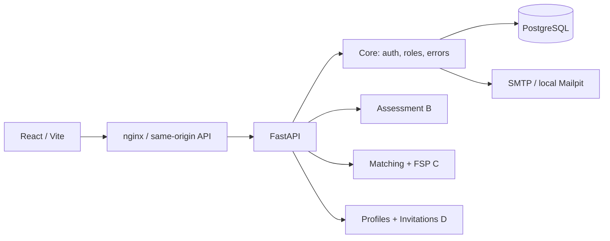

# Общий слой A

## Компоненты

Backend — модульный монолит. Один SQLAlchemy Session создаётся на запрос и не разделяется между конкурентными задачами. Миграции применяются Alembic до запуска API. Автоматического `create_all` при запуске приложения нет; отсутствующая схема даёт 503 на `/ready`.

## Зафиксированные решения

1. **Сессии:** 256-битные случайные непрозрачные токены. В БД только SHA-256; cookie `signal_session` — HttpOnly, SameSite=Lax, Secure в production. Абсолютный срок по умолчанию 8 часов. Новый вход меняет сессию текущего браузера, выход удаляет запись.
2. **CSRF:** отдельный случайный `signal_csrf`; в БД хранится хеш. Для изменяющих запросов с авторизацией необходим `X-CSRF-Token`. Небезопасные запросы с чужим Origin отклоняются, в том числе регистрация и вход. Токены не хранятся в localStorage.
3. **Письмо:** одноразовый токен со сроком 30 минут. Потребление выполнено условным UPDATE. Подтверждение инвалидирует остальные ссылки аккаунта. Повторная отправка не инвалидирует старую рабочую ссылку: анонимный запрос не может сорвать подтверждение владельцу.
4. **Доставка:** SMTP синхронный, с ограниченным timeout. Аккаунт и токен сохраняются до отправки; при сбое UI предлагает повтор. Для масштаба потребуется transactional outbox; очередь не нужна первому этапу хакатона.
5. **Лимиты:** атомарный upsert в БД, общий для процессов. На вход/регистрацию/повтор письма — 30 запросов за минуту с IP и 5 за 5 минут на email для каждой операции. На проверку токена — 30 за минуту с IP. Неподтверждённые proxy-заголовки не используются как источник IP. При внешнем размещении настроить доверенную цепочку прокси; иначе пользователи за общим прокси разделяют IP-лимит.
6. **Согласие при регистрации:** общий слой фиксирует неизменяемую квитанцию `registration_consents` в одной транзакции с аккаунтом. Это уточнение начального плана: A владеет технической квитанцией регистрации, D — согласиями публикации, приватностью и контактом. Порт `ConsentWrite` сохраняется. Так регистрация не ждёт полного модуля D и не создаёт фиктивного разрешения на публикацию.
7. **Компания:** C создаёт компанию через `/company` и назначает `User.company_id` на сервере в той же транзакции. В следующих запросах связь доступна в `ActorContext`; D читает компанию через `SqlAlchemyCompanyRead`. Клиент не может назначить себе чужую компанию.
8. **Стек:** Python 3.12; FastAPI/Pydantic/SQLAlchemy; React/TypeScript/Vite; PostgreSQL. SQLite используется для быстрого локального старта и части тестов. Точные версии записаны в lock-файлы.
9. **Контракты:** API экспортируется из кода; TypeScript-типы генерируются из OpenAPI. DTO общих доменных объектов экспортируются отдельно в JSON Schema. Зависимости B/C/D выражаются протоколами, а не прямой записью в чужие таблицы.
10. **UI:** готовые действия авторизации работают с реальным API. Будущие разделы обозначены как недоступные. Ни один фиктивный кандидат или результат теста не выдаётся пользователю как реальный.

## Хранение и безопасность

Миграция `0001_core` создаёт users, sessions, email_verifications, registration_consents, audit_events и rate_windows. Журнал содержит UUID, действие, время и request ID; не содержит пароли, email-токены и тела запросов. Ошибки валидации не возвращают исходный пароль. Публичных методов списка пользователей нет.

Ссылка из письма передаёт токен во fragment URL, чтобы он не попал в access-log web-сервера. Frontend убирает fragment из адресной строки и отправляет токен JSON-командой только после нажатия пользователем кнопки. Ответы API не кешируются. CSP web-сервера ограничивает загрузку ресурсов своим origin.

В дальнейшем добавить обслуживание просроченных verification/rate/audit-записей по согласованной политике хранения. На этом этапе старые записи лимита чистятся при повторных запросах того же ключа, просроченные сессии пользователя — при входе. Это не заменяет политику удаления персональных данных перед реальным запуском.
